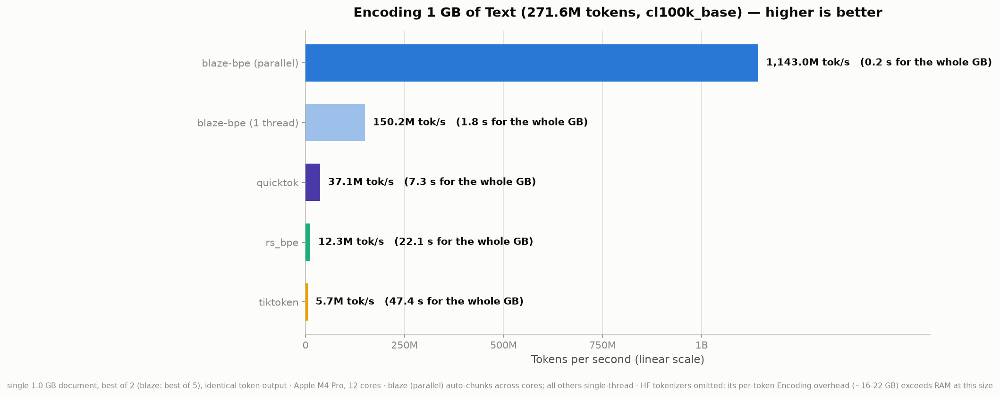
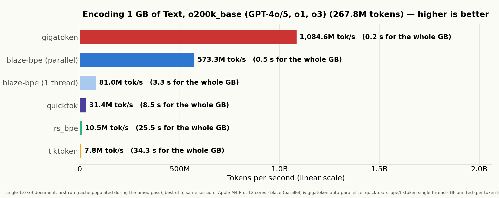
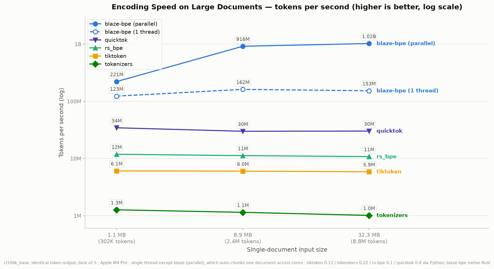
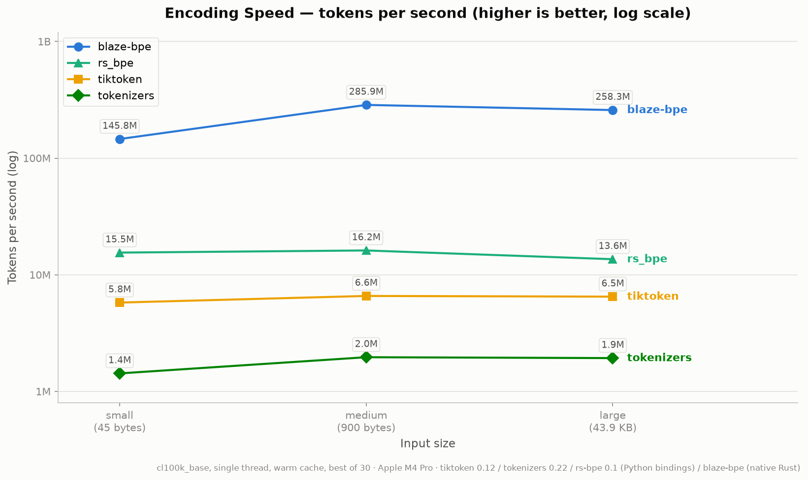

# blaze-bpe

A fast, tiktoken-compatible BPE tokenizer in Rust. Produces **byte-identical
output** to OpenAI's tiktoken for the `cl100k_base` (GPT-3.5/4) and
`o200k_base` (GPT-4o) encodings, verified against tiktoken-rs on edge cases,
6000 randomized fuzz strings, and full corpora.

## Benchmarks

Apple Silicon (M-series), single thread, vs tiktoken-rs 0.6:

| corpus (cl100k_base)  | blaze MB/s | tiktoken-rs MB/s | speedup |
|-----------------------|-----------:|-----------------:|--------:|
| english (shakespeare) |      543.5 |             14.6 |  37.1x  |
| source code           |      724.5 |             12.1 |  60.0x  |
| multilingual          |      368.9 |             19.9 |  18.5x  |
| json                  |      675.3 |             11.7 |  57.9x  |

o200k_base: 21.9x–28.0x. Batch encoding with rayon (545 × 2KB docs):
**~3.0 GB/s**. Chunked-parallel encoding of a *single* long document
(`encode` auto-splits at piece-safe boundaries above 256KB): **3.9 GB/s**
on an 8.9 MB document, 6.7x over sequential, byte-identical output.

### Cross-implementation showdown

Same machine, same corpus (shakespeare, 1.12 MB, cl100k_base), identical
token counts across all implementations (301,829). Rust rivals via
`cargo run --release --example showdown`, Python via tiktoken 0.12 /
tokenizers 0.22 / rs-bpe 0.1 (built from source, native target), Go via
omnitoken 0.1.4 / tiktoken-go 0.1.8 on go1.26:

| implementation           | single-thread MB/s | multicore batch MB/s |
|--------------------------|-------------------:|---------------------:|
| **blaze-bpe**            |          **617.1** |           **2960.6** |
| blaze-bpe (cold cache)   |              271.3 |                      |
| fastokens (Crusoe/NVIDIA)|              174.0 |                147.9 |
| omnitoken (pure Go)      |               60.3 |                      |
| bpe-openai (rust-gems)   |               53.5 |                127.6 |
| rs-bpe (Python bindings) |               46.7 |                      |
| tiktoken (Python, native core) |         21.8 |     89.3 (threads)   |
| tiktoken-rs              |               14.4 |                118.9 |
| tiktoken-go              |                9.2 |                      |
| HF tokenizers (Python)   |                4.7 |                 10.0 |

Chunked-parallel single document: 1330 MB/s (1.1 MB), 3877 MB/s (8.9 MB).
Counting without materializing tokens (`count`, same 1.1 MB doc,
chunked-parallel): 1230 MB/s.

Decode (ids -> text, same corpus): omnitoken 545 MB/s, blaze 480 MB/s,
rs-bpe 306 MB/s, tiktoken-go 194 MB/s, tiktoken (Python) 188 MB/s.

Rival marketing claims, re-measured here on identical input:

- **rs-bpe** advertises "up to 15.1x vs tiktoken on small texts"; measured:
  2.1x on the full document, 1.7x on 2000 unique ~46 B lines, 2.7x at best
  on a single repeated line where its result cache fully applies. blaze-bpe
  is ~13x rs-bpe single-threaded on the identical input.
- **omnitoken** advertises "15.84x CountTokens / 13.09x EncodeOrdinary vs
  tiktoken-go, 2.29x Decode"; measured: 6.4x / 6.3x / 2.8x — and the
  headline baseline (tiktoken-go, 9.2 MB/s) is a pure-Go port several times
  slower than tiktoken's real Rust core. blaze-bpe is ~10x omnitoken
  single-threaded on the identical input.

### Encoding 1 GB of text (cl100k_base)

One 1.0 GB document (shakespeare x900, 271,646,100 tokens), identical token
output across all implementations, M4 Pro. Rivals via their Python bindings
(FFI overhead is fully amortized at this size — every implementation's
throughput is flat from 32 MB to 1 GB); quicktok is the C++ tokenizer from
the HF forums, the fastest non-blaze implementation measured:

| implementation           | tokens/s   | wall time for 1 GB | vs tiktoken |
|--------------------------|-----------:|-------------------:|------------:|
| **blaze-bpe (parallel)** |  **1.14B** |         **0.24 s** |    **200x** |
| blaze-bpe (1 thread)     |       150M |              1.8 s |         26x |
| quicktok 0.4 (C++)       |      37.1M |              7.3 s |        6.5x |
| rs-bpe 0.1               |      12.3M |             22.1 s |        2.1x |
| tiktoken 0.12            |       5.7M |             47.4 s |          1x |



(HF tokenizers omitted at this size: its per-token `Encoding` metadata needs
~16-22 GB of RAM. At 32 MB it measures 1.0M tokens/s.)

Same 1 GB document with **o200k_base** (the encoding used by GPT-4o/4.1/5,
o1, o3 and o4-mini; 267,845,400 tokens, again byte-identical everywhere):
blaze parallel 590M tokens/s (0.45 s, **75x tiktoken**), blaze single-thread
87M tokens/s (11x), quicktok 31.4M (4.0x), rs-bpe 10.5M (1.3x), tiktoken
7.8M (34.2 s). The bigger vocab costs every implementation throughput in
MB/s, but tiktoken's regex-bound scanner is unaffected, so ratios compress
relative to cl100k.



### Throughput across document sizes

Single-document tokens/s at 1.1 MB / 8.9 MB / 32.3 MB (cl100k_base, log
scale; every implementation is flat across sizes, i.e. these are
steady-state numbers, and blaze's chunked-parallel line pulls further ahead
as the document grows):



At small inputs (45 B / 900 B / 43.9 KB — the sizes rs-bpe's marketing graph
uses) the same ranking holds, but the rivals' numbers are dominated by
Python call overhead, which is why small-text benchmarks flatter no one:



### vs Python tiktoken on one long document (32 MB, cl100k)

Interleaved measurement (`python3 scripts/ratio.py`), identical token output,
M4 Pro (8P+4E): tiktoken ~21 MB/s single-thread; blaze chunked-parallel
**~4.2 GB/s (~198x)**, warm sequential ~575 MB/s. Battery power throttles
all-core clocks; measure plugged in. Per-regime single-thread numbers
(`cargo run --release --example regimes`): cold/novel ~290 MB/s, warm/repeat
~580 MB/s, one unbroken novel CJK run ~100 MB/s (repeated CJK sentences hit
the long-piece cache and run at ~370 MB/s).

Reproduce with:

```sh
cargo test --release                     # byte-identical correctness vs tiktoken-rs
cargo run --release --example compare    # throughput comparison table
cargo bench                              # criterion benchmarks
```

## How it works

BPE tokenization is a two-stage pipeline, and blaze-bpe reimplements both
stages from scratch while reproducing tiktoken's semantics exactly:

1. **Pre-tokenization.** The input is split into *pieces* — words,
   contractions, number runs, punctuation clusters, whitespace runs —
   according to the cl100k/o200k splitting pattern. tiktoken does this with a
   backtracking regex engine; blaze-bpe implements the same splitting rules
   as a hand-written scanner (`src/scan.rs`), SIMD-accelerated on aarch64.
   Pieces never span this boundary, which is also what makes safe parallel
   chunking possible.

2. **BPE merge.** Each piece starts as a sequence of single bytes, and the
   lowest-ranked adjacent pair (per the vocab's merge ranks) is repeatedly
   merged until no adjacent pair exists in the vocab. Ranks equal token ids,
   so the final sequence of merged spans *is* the token ids. Before merging,
   each piece is looked up in per-thread caches — most words in real text
   repeat, so the merge loop only runs for genuinely novel pieces.

Special tokens (`encode_with_specials`) are found with an Aho-Corasick pass
that splits the text around them; everything between is encoded normally.
Decoding is a table lookup: each id maps back to its byte sequence, which are
concatenated and UTF-8-validated (`decode_bytes` skips validation).

Inputs above ~384KB are transparently split at provably piece-safe boundaries
and encoded on all cores (`encode`); `encode_batch` parallelizes over
documents instead. Both produce byte-identical output to sequential encoding.

## Why it's fast

1. **Bitmask pre-tokenization scanner** (`src/scan.rs`). tiktoken spends
   most of its time in `fancy_regex`, a backtracking regex engine. We
   implement the exact splitting semantics of the cl100k/o200k patterns
   (ordered alternation, possessive quantifiers, greedy backtracking)
   directly. On aarch64, cl100k classifies 64 bytes at a time with NEON into
   1-bit-per-byte class masks (letter/digit/newline/whitespace/non-ASCII);
   piece boundaries then come from shift + count-trailing-zeros instead of
   per-byte branches. A "pure lane" emits `word (space word)*` runs — the
   dominant shape in real text — at one ctz per piece with zero dispatch
   branches. Non-ASCII, contractions and window boundaries fall back to an
   exact scalar scanner with table-driven character classes.

2. **Id-pair merge table.** At load time we precompute
   `(left_id, right_id) -> merged_id` for every token splittable into two
   existing tokens. The merge loop then hashes a single `u64` per candidate
   pair instead of re-hashing byte slices like tiktoken's
   `ranks.get(&piece[start..end])`. Merge priority equals the merged token id,
   so greedy lowest-rank merging reproduces tiktoken exactly. Pieces longer
   than 128 bytes (unbroken CJK) switch from the O(n²) scan-for-min loop to a
   heap-based O(n log n) merge — ~11x on CJK.

3. **Direct-mapped piece caches.** Real text repeats words heavily. Pieces up
   to 16 bytes are packed into two words by a single unaligned 16-byte load
   plus branchless masking; a cache hit is one indexed load, three integer
   compares and a fixed 24-byte copy — no probing, no allocation. Each thread
   has an adaptive direct-mapped cache (2^18 × 48B slots), seeded on miss
   from a shared immutable table prebuilt from the vocab (every vocab token
   ≤ 16 bytes is a guaranteed single-token piece), so threads start warm and
   single-token pieces never merge. A second direct-mapped cache covers long
   pieces of 17–96 bytes (unbroken CJK letter-runs, long Cyrillic words) with
   exact byte verification per slot — repeated CJK sentences skip the merge
   loop entirely, taking multilingual text from ~90 to ~370 MB/s.

4. **Rayon batch encoding** (`encode_batch`), with per-thread caches and no
   shared mutable state.

5. **Chunked-parallel long documents.** `encode` transparently splits inputs
   above ~384KB into ~192KB chunks, encodes them in parallel, and
   parallel-copies the parts into the output at precomputed offsets. Cuts are
   only made at positions where a pre-tokenization piece provably ends
   regardless of scan alignment (after `\n` followed by non-whitespace, or
   between an ASCII letter and a following space/digit/punct other than `'`),
   so the result is byte-identical to sequential encoding;
   `encode_sequential` bypasses this. Inputs with no safe cut (e.g. unbroken
   CJK) fall back to sequential automatically.

Merging itself uses tiktoken's neighbor-update algorithm (recompute only the
two ranks adjacent to a merge) over `SmallVec` stack buffers — pieces are
short, so no heap allocation in the steady state.

## Usage

```rust
let tok = blaze_bpe::Tokenizer::cl100k_base("data/cl100k_base.tiktoken")?;
let ids = tok.encode("hello world");             // auto-parallel above 256KB
let ids = tok.encode_sequential(&long_text);     // force single-threaded
let ids = tok.encode_with_specials("<|endoftext|>hi");
let n   = tok.count("how many tokens?");
let all = tok.encode_batch(&docs);               // rayon-parallel
let s   = tok.decode(&ids)?;
```

Custom vocabularies: `Tokenizer::from_tiktoken_data(data, pattern, specials)`
accepts any `.tiktoken`-format vocab (base64 token + rank per line).

## Layout

- `src/scan.rs` — pre-tokenization scanners for both patterns
- `src/lib.rs` — vocab loading, pair-table construction, BPE merge, cache,
  encode/decode API
- `tests/correctness.rs` — byte-identical comparison vs tiktoken-rs
- `examples/compare.rs` — throughput comparison harness
- `data/` — vocab files (downloaded from OpenAI's public blob storage) and
  benchmark corpus
